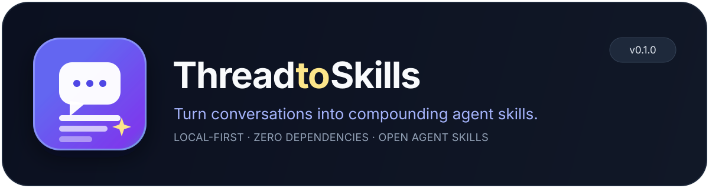
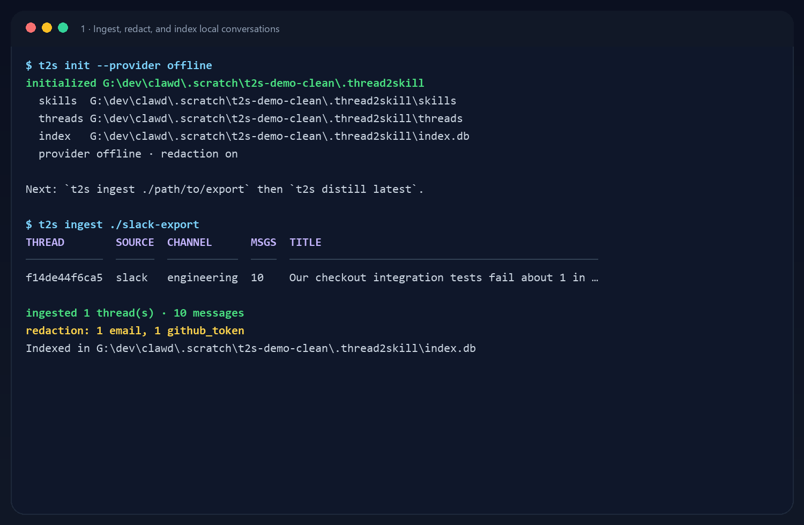
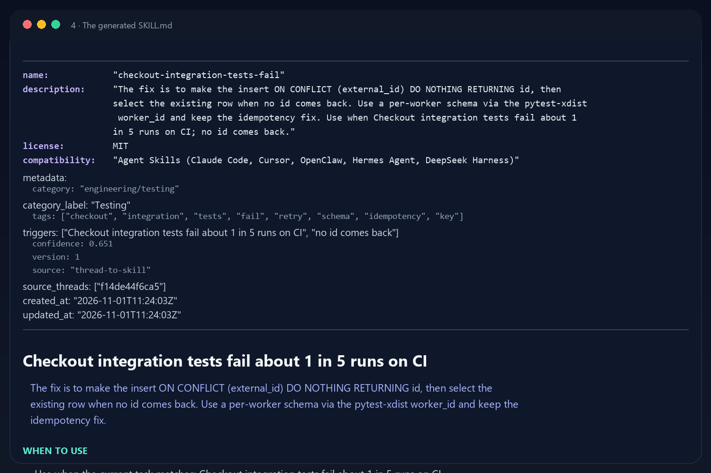
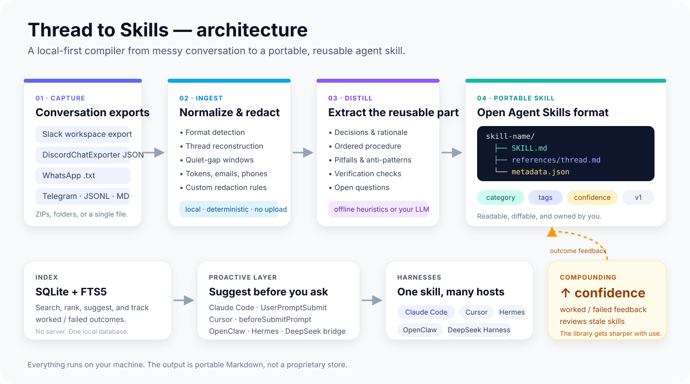
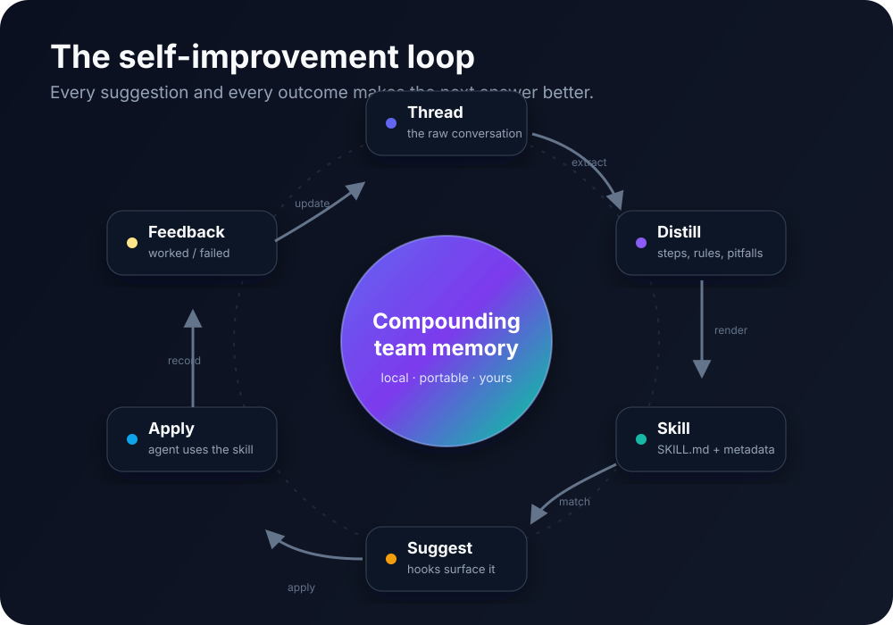

<p align="center">
  
</p>

<h1 align="center">thread-to-skill</h1>

<p align="center">
  <strong>Your team already solved this. Turn the thread into a skill.</strong>
</p>

<p align="center">
  <a href="https://github.com/fuleinist/thread-to-skill/actions/workflows/ci.yml"></a>
  
  
  
  
</p>

<p align="center">
  <a href="#why">Why</a> ·
  <a href="#quickstart">Quickstart</a> ·
  <a href="#how-it-works">How it works</a> ·
  <a href="#harness-support">Harnesses</a> ·
  <a href="#the-self-improvement-loop">Self-improvement</a> ·
  <a href="#privacy">Privacy</a> ·
  <a href="#cli">CLI</a> ·
  <a href="docs/index.md">Docs</a>
</p>

---

## Why

Every team has a channel where the real documentation lives.

A production incident gets debugged at 2am. Someone finds the root cause, writes the rollback command, and explains the trap that made it worse. Three weeks later, a different engineer hits the same failure and the thread is buried under 400 messages.

The knowledge is real. It is just trapped in a conversation.

**Thread to Skills** reads the Slack, Discord, or WhatsApp thread you already have and compiles it into a portable [Agent Skill](https://agentskills.io): a `SKILL.md` your agent can load on demand, with the procedure, decision rules, pitfalls, verification steps, and provenance intact.

It is not a summary. It is a reusable operating procedure.

<table>
<tr>
<td width="50%">

**Before**

- “Search the channel, maybe you’ll find it.”
- A 300-message thread nobody re-reads.
- The same outage debugged twice.
- Knowledge leaves when the person does.

</td>
<td width="50%">

**After**

- `SKILL.md` with steps, rules, and checks.
- Loaded only when the task matches.
- Suggested proactively by a hook.
- Confidence rises or falls with real outcomes.

</td>
</tr>
</table>

<p align="center">
  
</p>

---

## Quickstart

```bash
# 1. Clone and install (zero runtime dependencies)
git clone https://github.com/fuleinist/thread-to-skill.git
cd thread-to-skill
python -m pip install -e .

# 2. Create a local workspace
t2s init --provider offline

# 3. Point it at an export
t2s ingest ~/Downloads/slack-export
t2s ingest ./discord-export.json
t2s ingest ./WhatsApp\ Chat.txt

# 4. Distill the latest thread into a skill
t2s distill latest

# 5. See what you built
t2s list
t2s show <slug> --raw
```

`offline` is the default when no API key is present. It is deterministic, testable, and works on a plane. For nuanced distillation, use your own model:

```bash
# OpenAI-compatible endpoint
OPENAI_API_KEY=... t2s distill latest --provider openai --model gpt-4o-mini

# Anthropic
ANTHROPIC_API_KEY=... t2s distill latest --provider anthropic

# Local Ollama
t2s distill latest --provider ollama --model llama3.1

# Any command that reads a prompt on stdin and writes JSON on stdout
t2s distill latest --provider command --command "my-distiller"
```

When a similar skill already exists, Thread to Skills tells you. Merge the new evidence into it instead of creating another near-duplicate:

```bash
t2s distill latest --on-duplicate merge
```

---

## What you get

Every skill is a normal directory in the open Agent Skills format:

```text
.thread2skill/skills/checkout-integration-tests-fail/
├── SKILL.md                 # The skill: when, how, pitfalls, verification
├── references/thread.md     # Redacted source transcript, for evidence
└── metadata.json            # Category, tags, confidence, provenance, version
```

The generated `SKILL.md` looks like this:

```markdown
---
name: "checkout-integration-tests-fail"
description: "The fix is to make the insert idempotent... Use when ..."
metadata:
  category: "engineering/testing"
  tags: ["checkout", "integration", "tests", "fail", "retry", "schema"]
  confidence: 0.651
---

# Checkout integration tests fail about 1 in 5 runs on CI

## When to use
- Use when the current task matches: Checkout integration tests fail about 1 in 5 runs on CI.

## Procedure
1. **Make the insert ON CONFLICT (external_id) DO NOTHING RETURNING id...**
2. **Only retry on connection errors and 5xx responses**
3. **Use a per-worker schema via the pytest-xdist worker_id...**

## Decision rules
- **If** ... **then** ...

## Pitfalls
- **Don't retry on IntegrityError**
- **If you use --dist loadscope, all tests in a module share a worker...**

## Verification
- [ ] Run pytest tests/integration -n 4 --count=3 and confirm zero duplicate-key failures
```

<p align="center">
  
</p>

---

## How it works

<p align="center">
  
</p>

1. **Capture** — Slack workspace exports, DiscordChatExporter JSON, WhatsApp `.txt`, Telegram JSON, JSONL, generic JSON, Markdown, plain text, saved HTML pages (`.html` / `.htm`, best-effort: repeated author-and-timestamp blocks, otherwise one document), and ZIPs.
2. **Ingest & redact** — reconstruct threads, split unthreaded messages on a quiet gap, normalize timestamps and mentions, then remove tokens, keys, emails, phone numbers, private IPs, and credentials in URLs. Custom regexes are supported.
3. **Distill** — offline heuristics or an LLM extract decisions, ordered steps, conditions, pitfalls, and verification checks. Every claim keeps its source message IDs.
4. **Render** — write a validated `SKILL.md`, a redacted `references/thread.md`, and machine-readable `metadata.json`.
5. **Index** — store skills and threads in a local SQLite database with FTS5 search, duplicate detection, and usage scoring.
6. **Suggest** — hooks match the current prompt against the library and inject only the relevant skills.
7. **Learn** — `worked` / `failed` outcomes adjust confidence and flag stale skills for review.

The output is portable Markdown. No proprietary store, no hosted service, no lock-in.

---

## Harness support

One skill format, many hosts. `t2s install` copies the bundle into each harness’s native skill root. `t2s hooks install` writes the proactive-suggestion integration for the hosts that expose a prompt hook.

| Harness | Skill root | Proactive hook | Install |
|---|---|---|---|
| **Claude Code** | `~/.claude/skills` · `.claude/skills` | `UserPromptSubmit` in `.claude/settings.json` | `t2s hooks install --harness claude` |
| **Cursor** | `~/.cursor/rules` · `.cursor/rules` (`.mdc`) | `beforeSubmitPrompt` in `.cursor/hooks.json` | `t2s hooks install --harness cursor` |
| **OpenClaw** | `~/.openclaw/skills` · `skills/` | `before_prompt_build` plugin, `prependContext` | `t2s hooks install --harness openclaw` |
| **Hermes Agent** | `~/.hermes/skills/<category>` | `pre_llm_call` plugin, `{"context": ...}` | `t2s hooks install --harness hermes` |
| **DeepSeek Harness** | `~/.dsh/skills` · `.dsh/skills` | Claude Code hook bridge (`UserPromptSubmit`) | `t2s hooks install --harness deepseek` |
| **Cross-agent** | `~/.agents/skills` · `.agents/skills` | — | `t2s install <slug> --harness agents` |
| **Codex** | `~/.codex/skills` | — | `t2s install <slug> --harness codex` |
| **GitHub Copilot CLI** | `~/.copilot/skills` | — | `t2s install <slug> --harness copilot` |

Install into several at once:

```bash
t2s install <slug> --harness claude,cursor,agents
t2s install <slug> --harness all
```

Hooks call `t2s suggest`. Keep `t2s` on `PATH`, or set `T2S_BIN` to its absolute path. Hook files are merged into existing settings, backed up before writing, and never duplicated on re-run.

Nothing appears after a prompt that should match? Run `t2s hooks doctor`. It names the failing host and the reason. The exit code is non-zero when a detected hook is broken.

> **Scope:** v0.1 writes the documented hook shapes and covers them with fixtures. Agent harness APIs move quickly; after installing a hook, run a prompt that should match and verify the suggestion appears in your host version. Details and manual snippets: [docs/hooks.md](docs/hooks.md).

---

## The self-improvement loop

<p align="center">
  
</p>

The loop is deliberately **closed but human-governed**:

- A hook suggests a skill before the agent answers.
- The agent reads `SKILL.md` and applies it.
- The outcome is recorded:

```bash
t2s feedback <slug> --outcome worked
t2s feedback <slug> --outcome failed --note "the migration still drifted"
```

- Confidence moves up or down. After repeated failures with no successes, the status becomes `needs-review`.
- New evidence can be folded into the same skill with `t2s distill <thread> --on-duplicate merge`, which increments the version and keeps the provenance.

`t2s review` surfaces the other half of the loop. It lists stale, failing, unused,
duplicate, conflicting, and low-confidence skills. The command reads only. `t2s review --fix`
archives a needs-review skill only when that skill has zero successes.

What v0.1 automates: retrieval, proactive matching, confidence, and review flags. What stays explicit: rewriting skill content. A fully autonomous rewrite loop is roadmap work, not a hidden behavior. Everything is local and inspectable, so you can always see why a skill was suggested and what changed.

---

## Privacy

Thread to Skills is built for conversations you would not paste into a random website.

- **Local by default.** Ingest, redaction, extraction, indexing, and rendering run on your machine.
- **No telemetry.** No analytics, no phone-home, no account.
- **Redaction before storage.** Tokens, API keys, JWTs, emails, phone numbers, private IPs, credentials in URLs, and private keys are replaced before the normalized thread is written.
- **Redacted transcript is the evidence.** `references/thread.md` contains the cleaned conversation, not the original export.
- **LLM mode is explicit.** If you choose an API provider, the redacted thread is sent to that provider. That is the only network call the tool makes.
- **Opt out deliberately.** `t2s init --no-redact` exists for synthetic or public data. Do not use it on real customer conversations.

Redaction is a safety net, not a guarantee. Review a generated skill before sharing it outside your team.

---

## Install

Requirements: Python 3.10+. No runtime dependencies.

```bash
git clone https://github.com/fuleinist/thread-to-skill.git
cd thread-to-skill
python -m pip install -e .
```

Or install the CLI directly from the repository:

```bash
python -m pip install "git+https://github.com/fuleinist/thread-to-skill.git"
```

Verify:

```bash
t2s --version
t2s doctor
```

A PyPI release is planned. Until then, install from GitHub.

---

## CLI

| Command | What it does |
|---|---|
| `t2s init` | Create `.thread2skill/` with config, index, and skill directories |
| `t2s ingest <path...>` | Load exports, reconstruct threads, redact, and index |
| `t2s distill <thread...>` | Turn one or more threads into a skill |
| `t2s list` | List skills with category, confidence, status, and usage |
| `t2s show <slug>` | Show a skill, or `--raw` for the full `SKILL.md` |
| `t2s diff <slug>` | Compare two stored versions of a skill, with `--stat` or `--json` |
| `t2s search <query>` | Full-text search across local skills |
| `t2s suggest <prompt>` | Rank skills for a prompt; used by hooks |
| `t2s feedback <slug>` | Record `worked`, `failed`, `accepted`, or `suggested` |
| `t2s install <slug>` | Copy a skill into harness skill roots |
| `t2s hooks install` | Write proactive-suggestion hooks for supported harnesses |
| `t2s hooks doctor` | Verify installed hooks, their files, and the resolved command |
| `t2s validate` | Check generated skills against the Agent Skills format |
| `t2s stats` | Show workspace counts, categories, and recent events |
| `t2s review` | Find stale, failing, unused, duplicate, and conflicting skills |
| `t2s doctor` | Check Python, workspace, SQLite, PATH, and provider keys |

Full options: [docs/cli.md](docs/cli.md).

---

## Skill format

Thread to Skills writes the open [Agent Skills](https://agentskills.io) layout:

- `name` — lowercase, hyphenated, max 64 characters, matches the directory.
- `description` — what the skill does and when to use it, max 1024 characters.
- `license` — MIT for generated skills unless you change it.
- `compatibility` — the hosts the bundle targets.
- `metadata` — `category`, `tags`, `triggers`, `confidence`, `version`, `source_threads`, timestamps.
- `references/thread.md` — redacted provenance.
- `metadata.json` — full structured record used by the registry and future re-renders.

Categories are stable, filesystem-friendly keys such as `engineering/testing`, `operations/incidents`, and `engineering/security`. Hermes uses the top-level category as its skill folder; other hosts use the flat slug.

Details: [docs/skill-format.md](docs/skill-format.md).

---

## How is this different?

| | **book-to-skill** / **video-to-skill** | **Thread to Skills** |
|---|---|---|
| Source | A book, PDF, video, or course | A team conversation |
| Output | Study/reference skill | Operational procedure with decision rules and pitfalls |
| Strength | Depth of one source | The fix your team actually agreed on |
| Discovery | You ask for the skill | Hooks suggest it when the prompt matches |
| Evolution | Re-convert the source | Merge new threads, track worked/failed outcomes |
| Privacy | Local extraction | Local extraction + pre-storage redaction |

It is not RAG over chat history. Retrieval finds similar messages. Thread to Skills compiles a procedure once, names it, and gives the agent a stable artifact to apply.

---

## Status

**v0.1.0 — first public version.** The core CLI, offline and LLM distillation, redaction, registry, installers, hooks, validation, and test suite are working. Expect the skill schema and hook adapters to evolve as harness APIs change.

Roadmap:

- More adapters (Teams, Matrix, Zulip, exported HTML).
- Better offline extraction for implicit decisions and multi-thread synthesis.
- A `t2s review` workflow for stale and conflicting skills.
- Optional signed skill bundles for team distribution.
- PyPI release and a Homebrew formula.

---

## Docs

- [How it works](docs/how-it-works.md)
- [Architecture](docs/architecture.md)
- [Harness hooks](docs/hooks.md)
- [Skill format](docs/skill-format.md)
- [CLI reference](docs/cli.md)
- [FAQ](docs/faq.md)
- [Contributing](CONTRIBUTING.md)
- [Security](SECURITY.md)
- [Changelog](CHANGELOG.md)

---

## License

MIT. See [LICENSE](LICENSE).

Generated skills are yours. The converter ships no conversation content and no third-party datasets. The fixtures in `tests/fixtures/` are synthetic; names, domains, tokens, and URLs are fake.

<p align="center">
  <sub>Built for the threads that deserved a better ending.</sub>
</p>